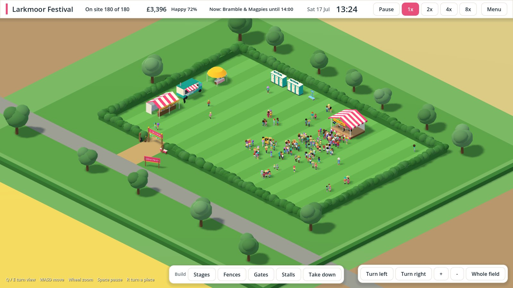

# Blueprint Festival

A management sim about running a UK music festival, built with **Godot 4.7 (.NET)** and **C#**.
You plan the event, lay out the site, run the day and tidy up afterwards. You start with a village
festival of 100 to 200 people and it grows each year only if the year went well.

It is a sister game to Blueprint Hospital and shares its look and its way of working, but all the
code here is written new for this game. Everything is fictional: no real festivals, artists,
brands or sponsors.



## Where it is up to

| Step | State |
|---|---|
| 1. An empty field: menu, field, turning camera, clock, day and night | Done |
| 2. People: festival-goers who arrive, walk about and go home | Done |
| 3. Building: three stages, four fences and two gates, with prices, and a queue at the gate | Done |
| 4. The show: seven made-up acts a day, a crowd that gathers and cheers, stage lights after dark | Done |
| 5. Needs and money: five stalls, queues, tickets at the gate, a money panel and a happiness score | Done |
| 6. The festival year: plan, build, run, tidy, results, grow | Next |
| 7. Staff and first aid | |
| 8. Crowd density and crush | |
| 9. Weather and mud | |
| 10. Growing up: more stages, medical tent, big crowds, camping from 5,000 | |
| 11. Sound and music: each act's own songs, crowd noise, clicks and a menu tune | |

## Controls

| Action | Control |
|---|---|
| Move the view | WASD or arrow keys, or drag with the middle mouse button |
| Zoom | Mouse wheel, or + and - bottom right |
| Turn the view a quarter turn | Q / E, or the turn buttons bottom right |
| Show the whole field | Home |
| Pause / resume | Space |
| Build | Pick from the build bar, click to place, drag for fence |
| Turn the piece being placed | R |
| Stop building | Right-click or Esc |
| Speed 1x / 2x / 4x / 8x | 1 / 2 / 3 / 4 |
| Menu (save, main menu) | Esc |

## Layout

```
game/                               Godot project (open this folder in Godot)
  Scenes/                           Main menu and festival scenes
  Scripts/Core/                     Game manager, saves, launch test, screenshot tool
  Scripts/UI/                       Look and feel, menus, top bar, view buttons
  Scripts/World/                    The 3D site, camera, daylight and people
src/BlueprintFestival.Simulation/   The rules of the game in plain C# (no Godot)
tests/BlueprintFestival.Simulation.Tests/   Unit tests for the rules
docs/handoff/                       The original brief and mock-ups
docs/screenshots/                   Screenshots from each step
```

The rules live in `src/` as plain C#, so they can be tested quickly without starting Godot. The
`game/` project only draws the world and takes input.

## Running it

You need **Godot 4.7.2 .NET** (the "mono" download) and the **.NET 8 SDK**.

1. Start Godot, choose **Import**, and select `game/project.godot`.
2. Press **Build** (the hammer, top right) once, then **Run Project** (F5).

## Checks

- `dotnet test tests/BlueprintFestival.Simulation.Tests` runs the unit tests.
- `godot --headless --path game -- --smoke-test` starts the game with no window, starts a festival,
  lets time pass until people arrive, pauses, turns the view, saves, loads and compares.
- `godot --path game -- --shots=DIR` writes review screenshots to a folder.
- `godot --path game -- --people-shots=DIR` writes line-up pictures of the people.

The tests and the launch test run on every pull request.

## Rules for this project

- No real festivals, artists, brands or sponsors.
- Medical uses a green cross, never a red one.
- Every character type is drawn in "style A" with its own uniform.
- Red, amber and green are kept for safety status.
