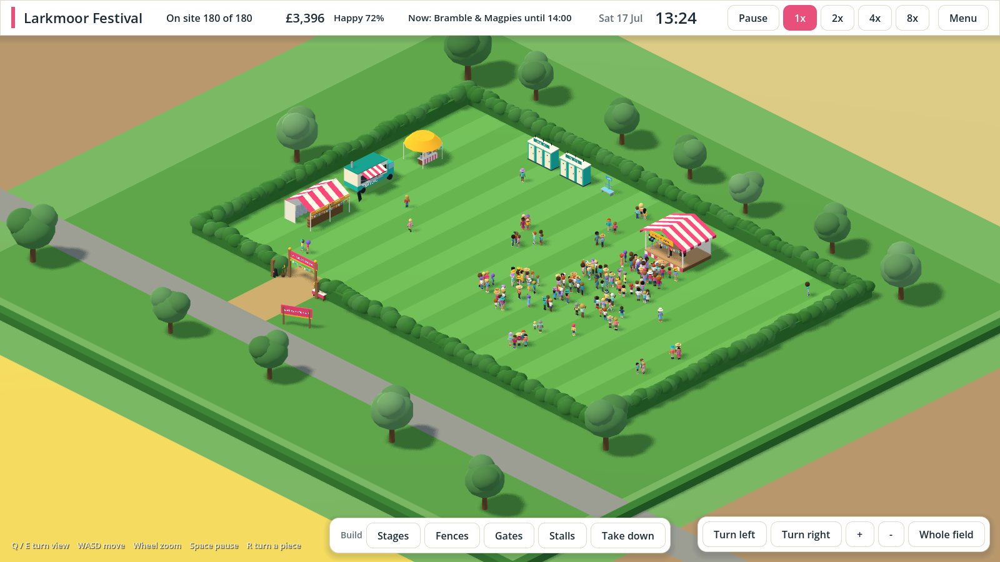
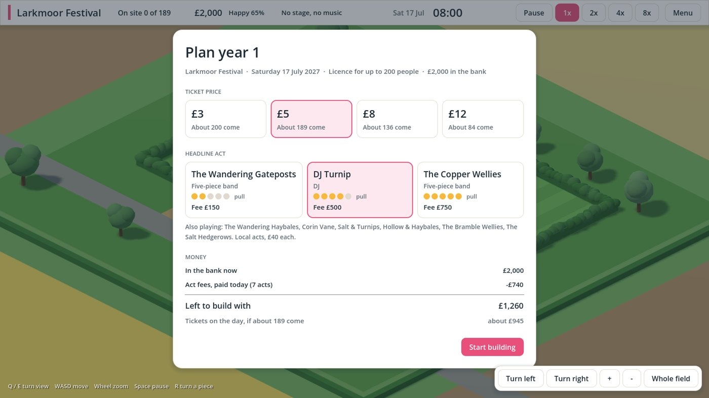
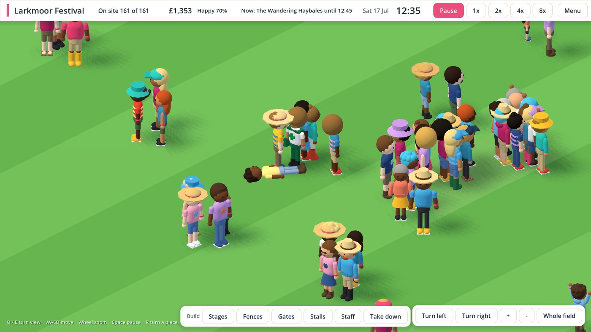

# Blueprint Festival

A management sim about running a UK music festival, built with **Godot 4.7 (.NET)** and **C#**.
You plan the event, lay out the site, run the day and tidy up afterwards. You start with a village
festival of 100 to 200 people and it grows each year only if the year went well.

It is a sister game to Blueprint Hospital and shares its look and its way of working, but all the
code here is written new for this game. Everything is fictional: no real festivals, artists,
brands or sponsors.








## Where it is up to

| Step | State |
|---|---|
| 1. An empty field: menu, field, turning camera, clock, day and night | Done |
| 2. People: festival-goers who arrive, walk about and go home | Done |
| 3. Building: three stages, four fences and two gates, with prices, and a queue at the gate | Done |
| 4. The show: seven made-up acts a day, a crowd that gathers and cheers, stage lights after dark | Done |
| 5. Needs and money: five stalls, queues, tickets at the gate, a money panel and a happiness score | Done |
| 6. The festival year: plan the ticket price and headliner, build, run the day, clear the litter, read the results, grow | Done |
| 7. Staff and first aid: ticket staff on the gate, security, first-aiders and a first aid tent, with people taken ill and trouble to sort out | Done |
| 8. Crowd density and crush: a crowd view in green, amber and red, big names that pack the front, a front barrier, pausing the act, and a day called off if people are hurt | Done |
| 9. Weather and mud: a forecast, rain, heat, ponchos, mud where wet grass is walked on, straw and trackway, and a bill from the farmer for worn-out grass | Done |
| 10a. Growing up: a licence ladder from 200 to 5,000, three fields, a main stage, turnstiles and a toilet block, and crowds of thousands drawn and run at speed | Done |
| 10b. A second stage with its own line-up, booked at planning, and a medical tent with six beds | Done |
| 10c. Camping, as an option at 5,000: a camping field next door, tents, campers who stay the night | Done |
| 11. Sound effects: the field, the weather, the crowd, stalls, building, the radio and buttons, with volume sliders | Done (files made with `tools/make_sounds.py`) |
| 12. Artists and music: 25 made-up artists with a genre, a rating and a following, and a folder each for their songs | Done (songs are added to `game/Music`) |
| 13. Selling tickets: book every set yourself in January, advertise and sell month by month, then build week with the last tickets sold day by day | Done |
| 14. Paths and a scattered campsite: mown, bark chip and gravel paths that about half the crowd keeps to (most on a wet day), and tents dotted about a bigger camping field | Done |
| 15. Balance: dear tickets sell far fewer and put people in a worse mood, the last tickets are the hardest to sell, better acts lift the mood more, the festival keeps a quarter of stall takings, and the council wants £5 a head in the bank before a bigger field | Done |
| 16a. The estate map: nineteen named fields round the lane, rented each January for music, food, camping or parking, with a site laid out from whichever fields are chosen | Done |
| 16b. Getting there: villagers walk, car park fields with bays and a parking charge, shuttle buses to the bus stop on the lane, and nobody buys a ticket without a way to get there | Done |
| 17. Dancing to the beat: each song's beat is worked out once and saved beside it, and the crowd dances in time to it, with a move for each sort of music | Done |
| 18a. Proper queues: people stand one behind the next at gates and stalls, long queues bend and fold back instead of piling up, each person holds up a ticket at the gate, and a stall has one queue with each server taking the next party | Done |
| 18b. Toilets: one queue for each set of cabins, each person walks to a free cubicle, the door swings open and shuts behind them, the sign turns red while they are inside and green when they come out, and they wait nearby for the rest of their party | Done |
| 18c. Queue lanes and staff-only ground: drag a queue along the ground for a gate, a stall or the toilets and the barriers go up either side by themselves, round corners too; and mark ground "no customers", which the public walk round, staff do not, and which only shows while you are marking it | Done |
| 19. The band plays to the music: the drummer's sticks come down on each drum on the beat and the drums shake, guitars are strummed on the beat, the singer's mouth moves with the singing; a few seconds between songs while the crowd claps and cheers; the last song fades at the end of a set, the crowd cheers louder and most stay to clap the act off before they go | Done |
| 21. Lights: path lights and floodlights are clicked down, fairy lights are dragged from one place to another and their poles go in by themselves (start on a pole to carry on from it, at any angle). They come on as it gets dark and light the ground round them; after dark people about on unlit ground slowly lose heart | Done |
| 22. Big screens: small, medium and large screens on scaffold towers with speakers, on the Stages group, showing the nearest stage live from the front camera. People more than 20 m from a stage enjoy an act less the further back they are, unless they are in front of a screen (25, 40 or 60 m) | Done |
| 23. Lighting: the sun crosses the sky, so shadows are long in the morning, short at midday and long and golden in the evening, and everyone casts one; dusk and night are darker and bluer; lamps, fairy lights and stage beams glow, floodlights throw shadows and stalls have a lamp of their own. Shadows can be turned off from the pause menu or the main menu on a slower computer | Done |
| 24. Fireworks: a small or big launch pad from the Fireworks button on the build bar, with a safe zone round it that must be clear and should be fenced off (£2 a metre). On the firework mixer the player plans up to four 30-second shows a day at times they pick from 8pm, dragging eight kinds of firework onto a timeline in three rows. A good show in the dark cheers everyone up (up to +10%); with no fence people wander in, everyone is put out and someone may be burned; anything built in the safe zone gets the show called off. Clicking the pad opens the mixer, and "Watch it now" lets a show off as a try-out | Done |
| 25a. Seats, hand washing, shade and floors: straw bales, benches, deckchairs, picnic and parasol tables and a seating marquee on a new Comforts group; people with food look for a seat near where they bought it, others stop for a rest, and a sit down lifts the mood a little. Hand gel posts and hand wash stations by the toilets and food cut tummy bugs. Parasols, a shade sail and the marquee keep rain and hot sun off whoever is under them. A phone charging tent takes money. Five new floors (pallets, sand, rubber mats, artificial grass, boardwalk), with paths on a group of their own that can be dragged 2, 4 or 6 m wide | Done |
| 25b. Signs with your own words: a sandwich board, a finger post with up to three fingers that each point left or right, a banner to walk under and a site map board that draws the site as built, on a new Signs group. A box opens to type the words and pick a colour when a sign goes up or is clicked. A sandwich board brings stalls within 8 m a quarter more passing trade; people near a finger post or a map board mind a longer walk to a stall less | Done |
| 25c. Decorations: bunting dragged between poles by the metre, a scarecrow, flower planters, flag poles, a fire pit that glows after dark, giant sunflowers and the festival's name in giant letters, on a Decorations shelf beside Signs on the Decor tab. People near them are a little happier, up to a cap, and a fire pit counts double at night | Done |
| 26. VIPs: one ticket in ten is a VIP ticket with its own price on the sales screen (it starts at three times the ordinary price). VIP guests wear a gold lanyard. VIP ground (Fences group, free) is ground only VIPs and staff walk on, shown in gold only while it is being marked, and seats put on it are VIP seats. The VIP lounge (£600) is an open-sided marquee with sofas and its own bar; the VIP viewing platform (£300) is a raised deck VIPs watch the nearest stage from. Any stall can be kept for VIPs from its board, and a VIP sign goes up outside. VIPs enjoy VIP things and grumble if they paid extra for nothing | Done |
| 27. The fairground: a carousel, big wheel, waltzer, twister, the Skylark (a tower with a long arm that swings right over) and hook a duck, on a Fairground shelf of the Stalls tab. Each is hired for the day and the player sets what a ride costs by clicking it; a ride stands to load, runs, and lets everybody off together. About one go in four at hook a duck wins a big teddy that is carried all day. The fairground cannot go in a camping field | Done |

## Controls

| Action | Control |
|---|---|
| Move the view | WASD or arrow keys, or drag with the middle mouse button |
| Zoom | Mouse wheel, or + and - bottom right |
| Turn the view a quarter turn | Q / E, or the turn buttons bottom right |
| Show the whole field | Home |
| Pause / resume | Space |
| Crowd view on / off | C, or the button bottom right |
| Build | Pick from the build bar, click to place, drag for fence, ground cover and paths |
| Turn the piece being placed | R |
| Stop building | Right-click or Esc |
| Speed 1x / 2x / 4x / 8x (16x / 32x for testing) | 1 / 2 / 3 / 4 (5 / 6) |
| Menu (save, main menu) | Esc |

## Layout

```
game/                               Godot project (open this folder in Godot)
  Scenes/                           Main menu and festival scenes
  Audio/                            The list of sound effects (sounds.json) and their files
  Music/                            A folder for each artist's songs
  Fonts/                            The poster font (Fraunces) and the text font (Inter), both free to ship
  Scripts/Audio/                    The sound board and what the festival sounds like
  Scripts/Core/                     Game manager, saves, launch test, screenshot tool
  Scripts/UI/                       Look and feel, menus, top bar, view buttons
  Scripts/World/                    The 3D site, camera, daylight and people
src/BlueprintFestival.Simulation/   The rules of the game in plain C# (no Godot)
tests/BlueprintFestival.Simulation.Tests/   Unit tests for the rules
tools/make_sounds.py                Makes the sound effect files with ElevenLabs
docs/handoff/                       The original brief and mock-ups
docs/screenshots/                   Screenshots from each step
```

The rules live in `src/` as plain C#, so they can be tested quickly without starting Godot. The
`game/` project only draws the world and takes input.

## The look

Every screen is styled as a festival programme: white paper with pink and sunflower bunting, poster
headings, the ticket price on a ticket stub and the results as a parish newsletter. The shared pieces
(colours, fonts, icons, bunting, the ticket) are all in `game/Scripts/UI/UiStyle.cs`. The mock-ups it
was chosen from are in `docs/screenshots/step-17-mockup/`.

## Running it

You need **Godot 4.7.2 .NET** (the "mono" download) and the **.NET 8 SDK**.

1. Start Godot, choose **Import**, and select `game/project.godot`.
2. Press **Build** (the hammer, top right) once, then **Run Project** (F5).

## Sound

Every sound effect is on one list, `game/Audio/sounds.json`: its name, how long it is, whether it
plays round and round, how loud it is, and a description of what it should sound like. The game
plays `game/Audio/<name>.ogg` (or `.wav` or `.mp3`) if the file is there and is silent if it is
not, so a sound can be swapped by dropping a new file in with the same name.

`python3 tools/make_sounds.py` makes every missing file from its description with ElevenLabs. It
needs an ElevenLabs key in the `ELEVENLABS_API_KEY` environment variable (never put the key in a
file in this project). `--list` shows what is there, and `--only till,fry --force` makes chosen
sounds again. The acts' music is not part of this and comes later.

The volume sliders are in the pause menu (Esc) and on the main menu, and are remembered.

When the crowd claps along (the sway, mostly to country), one of the three `clap_` sounds plays
on each clap of the beat of the music being heard, louder the more people are clapping. Those
sounds have a `keep` length in the list: `make_sounds.py` cuts them to start right on the clap,
so they are not late.

## The festival year

- **January, the fields.** The year opens on a map of the Larkmoor estate. You click a field and
  say what it is for: music, food and stalls, camping or a car park. Each field has its own size,
  rent and room. Festival fields must share a hedge so a gateway can join them, and one of them
  must touch the lane or the farm track. Tickets on sale are the room in the music fields or the
  licence, whichever is smaller. Stages go only in music fields and tents only in camping fields;
  stalls can go on any rented grass. In the first year the parish lends the village green and
  that is the only field.
- **Getting there.** About 250 people live near enough to walk. Everyone else needs a space in a
  car park field (two and a half people a car) or a seat on a shuttle bus from the station (150
  people a bus over the day, £120 each, paid on the morning). Someone with no way to get there
  does not buy a ticket, so a big year needs car parks, buses or both. You set the parking charge:
  up to £5 nobody minds, and each pound over that puts off some drivers. Cars fill the bays
  through the day and the bus pulls in at the stop on the lane every quarter of an hour. Parking
  and buses can be changed in January, while tickets sell and in build week.
- **January.** You book the line-up. Each stage has four sets, at 14:00, 16:00, 18:00 and 20:00. An act
  plays for an hour and a half and the stage is then empty for half an hour, when people go for a
  drink, some food or the toilet. On the day, Skip to next act (or N) hurries the clock on to the
  next set. Any of the 25 artists can play any set, an artist plays once, and a set can be left empty.
  You can add a second stage for four more sets. You set the ticket price in whole pounds.
- **January to June.** Tickets are on sale and each month is one turn. You switch adverts on and
  off (15 of them, from posters in shop windows to national TV), change the price if you like, and
  run the month. Adverts decide how many people hear about the festival. The line-up and the price
  decide how many of them buy: more stars and more fans sell more, a price above what the line-up
  is worth sells much more slowly, and a price below it sells fast. The keenest people buy first, so
  the last few hundred tickets take the most selling. A festival people enjoyed last year sells
  more by word of mouth. Sales speed up as July comes.
- **July, build week.** You lay out the field. Ending each of the seven days sells that day's
  tickets, and the price can still change.
- **The day.** The crowd is the people who bought a ticket. They arrive pleased if the ticket was a bargain
  and expecting a lot if it was dear, and a five star act lifts the mood about three times as much
  as a one star act.

The rules are in `src/BlueprintFestival.Simulation/FestivalGame.Sales.cs` and
`Sales/Adverts.cs`.

## Artists and music

There are 25 made-up artists (solo guitarists, duos, full bands and DJs), each with a genre, a
rating out of five and a following. They are listed in `game/Music/README.txt` and in
`src/BlueprintFestival.Simulation/Show/Acts.cs`.

Each artist has a folder with their name on it under `game/Music`. Put that artist's songs in it,
named with a number and the title: `01 Song Title.mp3`, `02 Another Song.mp3`. The number is the
playing order and the title is what the game shows. `.mp3`, `.ogg` and `.wav` all work. During an
artist's set their songs play in order and round again; an artist with no songs plays in silence.
The music has its own volume slider.

An artist with 20,000 fans or more draws a crowd before they come on: people start filling the
front of the stage 20 game minutes before the set (`RunningOrder.FillingUp`). A crush can build
while they wait, and the crush choices work then too (the announcement asks them to step back, and
cancelling calls the set off before it starts).

From the stage cameras there is a sky (`game/Scripts/World/Sky.Dome.cs`): blue with a few clouds by
day, gold and pink at sunset, stars and the moon at night, grey under rain. It follows the same
clock and weather as the lighting. The view of the site looks down on the field and never shows it.

### Dancing to the beat

The crowd dances in time to the music. The first time the game runs with a new song, it listens to
it quietly in the background (a few seconds a song, the act on stage first) and writes the beat
into a small text file beside the song: `01 Song Title.mp3.beat`. That file holds the tempo, where
the first beat falls and the time of every beat, so the crowd keeps time even if the players drift.
Edit the numbers if the crowd is ever out of time, or delete the file to have it worked out again.
`godot --path game -- --work-out-beats` does every song in one go and prints what it found.

The crowd moves on every other beat, so each move has time to wind up and land smoothly. Each
sort of music has its own move: pop bounces with hands up, rock head-bangs, metal head-bangs
harder with horns, electronic jumps, country sways and claps, and hip hop nods with a hand pumping.
About one in five does a gentler move that still suits the music, and one in ten just nods along.
Everyone is a touch ahead of or behind the beat, and some dance harder than others. An act with no
songs, or a song whose beat is not worked out yet, gets a steady beat that suits its music, and the
crowd at the stage that is not being heard dances to that too.

### The band plays along

The act plays to the same beat the crowd dances to. The drummer sits at a kit of bass drum, snare,
two toms, a floor tom, hi-hat and crash: the right stick keeps time on the hi-hat (a crash at the
start of every fourth bar), the left hits the snare on the second and fourth beats, and the end of
every fourth bar is a fill round the toms. Each stick comes down on its drum exactly on its beat,
and the drum swells or the cymbal rocks as it is hit. Guitars and bass are strummed down across
the strings on each beat and up between, with the other hand changing chords on the neck. The
singer sings into the mic, their mouth opening with the singing that is heard (the middle of the
sound is listened to as it plays), and waves, points, holds the mic with both hands or claps over
their head. The keyboard player plays, the DJ scratches and punches the air, rock and metal
players jump at the end of every eighth bar.

When a song ends the stage is quiet for a few seconds: the crowd stops dancing to clap and cheer
(`song_end_` sounds and the `applause_loop`), and the singer thanks them. Near the end of a set
no new song starts, and the last one fades away over its last seconds. The act then stays on for
three minutes to wave and bow while the crowd cheers and claps, louder than between songs. Most of
those watching hold on for the end of a set unless a need is desperate, and stay to clap for one
to three minutes before they drift off to the stalls or home.

## Checks

- `dotnet test tests/BlueprintFestival.Simulation.Tests` runs the unit tests.
- `godot --headless --path game -- --smoke-test` starts the game with no window, starts a festival,
  lets time pass until people arrive, pauses, turns the view, saves, loads and compares.
- `godot --path game -- --shots=DIR` writes review screenshots to a folder.
- `godot --path game -- --people-shots=DIR` writes line-up pictures of the people.
- `godot --path game --write-movie FILE.avi --fixed-fps 30 -- --band-shots=DIR` films a band
  playing (close-ups of the drummer, singer and guitarist), the end of a song and the end of a set.
- `godot --path game -- --sales-shots=DIR` writes pictures of the planning and ticket sales screens.
- `godot --path game -- --path-shots=DIR` writes pictures of paths and the camping field.
- `godot --path game -- --queue-shots=DIR` writes pictures of the queues at gates, stalls and toilets, of queue lanes, and of ground marked "no customers".
- `godot --path game -- --light-shots=DIR` writes pictures of the lights by day, at dusk and at night.
- `godot --path game -- --vip-shots=DIR` writes pictures of the lanyards, VIP ground, the lounge, the platform and a stall kept for VIPs.

The tests and the launch test run on every pull request.

## Rules for this project

- No real festivals, artists, brands or sponsors.
- Medical uses a green cross, never a red one.
- Every character type is drawn in "style A" with its own uniform.
- Red, amber and green are kept for safety status.
