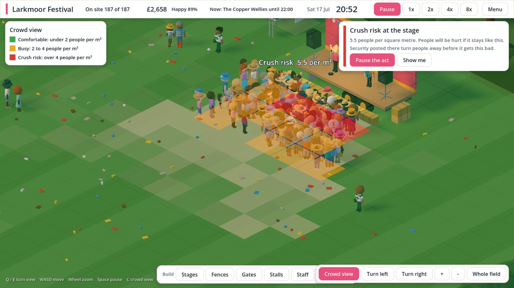

# Blueprint Festival

A management sim about running a UK music festival, built with **Godot 4.7 (.NET)** and **C#**.
You plan the event, lay out the site, run the day and tidy up afterwards. You start with a village
festival of 100 to 200 people and it grows each year only if the year went well.

It is a sister game to Blueprint Hospital and shares its look and its way of working, but all the
code here is written new for this game. Everything is fictional: no real festivals, artists,
brands or sponsors.




## Where it is up to

| Step | State |
|---|---|
| 1. An empty field: menu, field, turning camera, clock, day and night | Done |
| 2. People: festival-goers who arrive, walk about and go home | Done |
| 3. Building: three stages, four fences and two gates, with prices, and a queue at the gate | Done |
| 4. The show: seven made-up acts a day, a crowd that gathers and cheers, stage lights after dark | Done |
| 5. Needs and money: five stalls, queues, tickets at the gate, a money panel and a happiness score | Done |
| 6. The festival year: plan the ticket price and headliner, build, run the day, clear the litter, read the results, grow | Done |
| 7. Staff and first aid: ticket staff on the gate, security, first-aiders and a first aid tent, with people taken ill and trouble to sort out | Done |
| 8. Crowd density and crush: a crowd view in green, amber and red, big names that pack the front, a front barrier, pausing the act, and a day called off if people are hurt | Done |
| 9. Weather and mud: a forecast, rain, heat, ponchos, mud where wet grass is walked on, straw and trackway, and a bill from the farmer for worn-out grass | Done |
| 10a. Growing up: a licence ladder from 200 to 5,000, three fields, a main stage, turnstiles and a toilet block, and crowds of thousands drawn and run at speed | Done |
| 10b. A second stage with its own line-up, booked at planning, and a medical tent with six beds | Done |
| 10c. Camping, as an option at 5,000: a camping field next door, tents, campers who stay the night | Done |
| 11. Sound effects: the field, the weather, the crowd, stalls, building, the radio and buttons, with volume sliders | Done (files made with `tools/make_sounds.py`) |
| 12. Artists and music: 25 made-up artists with a genre, a rating and a following, and a folder each for their songs | Done (songs are added to `game/Music`) |
| 13. Selling tickets: book every set yourself in January, advertise and sell month by month, then build week with the last tickets sold day by day | Done |
| 14. Paths and a scattered campsite: mown, bark chip and gravel paths that about half the crowd keeps to (most on a wet day), and tents dotted about a bigger camping field | Done |
| 15. Balance: dear tickets sell far fewer and put people in a worse mood, the last tickets are the hardest to sell, better acts lift the mood more, the festival keeps a quarter of stall takings, and the council wants £5 a head in the bank before a bigger field | Done |
| 16a. The estate map: nineteen named fields round the lane, rented each January for music, food, camping or parking, with a site laid out from whichever fields are chosen | Done |
| 16b. Getting there: villagers walk, car park fields with bays and a parking charge, shuttle buses to the bus stop on the lane, and nobody buys a ticket without a way to get there | Done |

## Controls

| Action | Control |
|---|---|
| Move the view | WASD or arrow keys, or drag with the middle mouse button |
| Zoom | Mouse wheel, or + and - bottom right |
| Turn the view a quarter turn | Q / E, or the turn buttons bottom right |
| Show the whole field | Home |
| Pause / resume | Space |
| Crowd view on / off | C, or the button bottom right |
| Build | Pick from the build bar, click to place, drag for fence, ground cover and paths |
| Turn the piece being placed | R |
| Stop building | Right-click or Esc |
| Speed 1x / 2x / 4x / 8x | 1 / 2 / 3 / 4 |
| Menu (save, main menu) | Esc |

## Layout

```
game/                               Godot project (open this folder in Godot)
  Scenes/                           Main menu and festival scenes
  Audio/                            The list of sound effects (sounds.json) and their files
  Music/                            A folder for each artist's songs
  Scripts/Audio/                    The sound board and what the festival sounds like
  Scripts/Core/                     Game manager, saves, launch test, screenshot tool
  Scripts/UI/                       Look and feel, menus, top bar, view buttons
  Scripts/World/                    The 3D site, camera, daylight and people
src/BlueprintFestival.Simulation/   The rules of the game in plain C# (no Godot)
tests/BlueprintFestival.Simulation.Tests/   Unit tests for the rules
tools/make_sounds.py                Makes the sound effect files with ElevenLabs
docs/handoff/                       The original brief and mock-ups
docs/screenshots/                   Screenshots from each step
```

The rules live in `src/` as plain C#, so they can be tested quickly without starting Godot. The
`game/` project only draws the world and takes input.

## Running it

You need **Godot 4.7.2 .NET** (the "mono" download) and the **.NET 8 SDK**.

1. Start Godot, choose **Import**, and select `game/project.godot`.
2. Press **Build** (the hammer, top right) once, then **Run Project** (F5).

## Sound

Every sound effect is on one list, `game/Audio/sounds.json`: its name, how long it is, whether it
plays round and round, how loud it is, and a description of what it should sound like. The game
plays `game/Audio/<name>.ogg` (or `.wav` or `.mp3`) if the file is there and is silent if it is
not, so a sound can be swapped by dropping a new file in with the same name.

`python3 tools/make_sounds.py` makes every missing file from its description with ElevenLabs. It
needs an ElevenLabs key in the `ELEVENLABS_API_KEY` environment variable (never put the key in a
file in this project). `--list` shows what is there, and `--only till,fry --force` makes chosen
sounds again. The acts' music is not part of this and comes later.

The volume sliders are in the pause menu (Esc) and on the main menu, and are remembered.

## The festival year

- **January, the fields.** The year opens on a map of the Larkmoor estate. You click a field and
  say what it is for: music, food and stalls, camping or a car park. Each field has its own size,
  rent and room. Festival fields must share a hedge so a gateway can join them, and one of them
  must touch the lane or the farm track. Tickets on sale are the room in the music fields or the
  licence, whichever is smaller. Stages go only in music fields and tents only in camping fields;
  stalls can go on any rented grass. In the first year the parish lends the village green and
  that is the only field.
- **Getting there.** About 250 people live near enough to walk. Everyone else needs a space in a
  car park field (two and a half people a car) or a seat on a shuttle bus from the station (150
  people a bus over the day, £120 each, paid on the morning). Someone with no way to get there
  does not buy a ticket, so a big year needs car parks, buses or both. You set the parking charge:
  up to £5 nobody minds, and each pound over that puts off some drivers. Cars fill the bays
  through the day and the bus pulls in at the stop on the lane every quarter of an hour. Parking
  and buses can be changed in January, while tickets sell and in build week.
- **January.** You book the line-up. Each stage has four sets, at 14:00, 16:00, 18:00 and 20:00. An act
  plays for an hour and a half and the stage is then empty for half an hour, when people go for a
  drink, some food or the toilet. On the day, Skip to next act (or N) hurries the clock on to the
  next set. Any of the 25 artists can play any set, an artist plays once, and a set can be left empty.
  You can add a second stage for four more sets. You set the ticket price in whole pounds.
- **January to June.** Tickets are on sale and each month is one turn. You switch adverts on and
  off (15 of them, from posters in shop windows to national TV), change the price if you like, and
  run the month. Adverts decide how many people hear about the festival. The line-up and the price
  decide how many of them buy: more stars and more fans sell more, a price above what the line-up
  is worth sells much more slowly, and a price below it sells fast. The keenest people buy first, so
  the last few hundred tickets take the most selling. A festival people enjoyed last year sells
  more by word of mouth. Sales speed up as July comes.
- **July, build week.** You lay out the field. Ending each of the seven days sells that day's
  tickets, and the price can still change.
- **The day.** The crowd is the people who bought a ticket. They arrive pleased if the ticket was a bargain
  and expecting a lot if it was dear, and a five star act lifts the mood about three times as much
  as a one star act.

The rules are in `src/BlueprintFestival.Simulation/FestivalGame.Sales.cs` and
`Sales/Adverts.cs`.

## Artists and music

There are 25 made-up artists (solo guitarists, duos, full bands and DJs), each with a genre, a
rating out of five and a following. They are listed in `game/Music/README.txt` and in
`src/BlueprintFestival.Simulation/Show/Acts.cs`.

Each artist has a folder with their name on it under `game/Music`. Put that artist's songs in it,
named with a number and the title: `01 Song Title.mp3`, `02 Another Song.mp3`. The number is the
playing order and the title is what the game shows. `.mp3`, `.ogg` and `.wav` all work. During an
artist's set their songs play in order and round again; an artist with no songs plays in silence.
The music has its own volume slider.

## Checks

- `dotnet test tests/BlueprintFestival.Simulation.Tests` runs the unit tests.
- `godot --headless --path game -- --smoke-test` starts the game with no window, starts a festival,
  lets time pass until people arrive, pauses, turns the view, saves, loads and compares.
- `godot --path game -- --shots=DIR` writes review screenshots to a folder.
- `godot --path game -- --people-shots=DIR` writes line-up pictures of the people.
- `godot --path game -- --sales-shots=DIR` writes pictures of the planning and ticket sales screens.
- `godot --path game -- --path-shots=DIR` writes pictures of paths and the camping field.

The tests and the launch test run on every pull request.

## Rules for this project

- No real festivals, artists, brands or sponsors.
- Medical uses a green cross, never a red one.
- Every character type is drawn in "style A" with its own uniform.
- Red, amber and green are kept for safety status.
